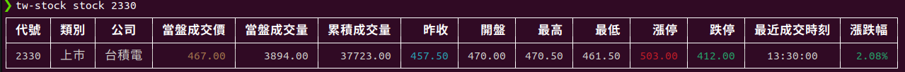
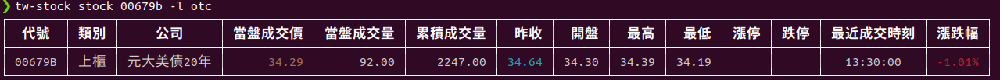
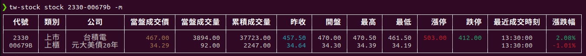

# tw-stock

A command-line tool for quickly searching Taiwan stock market information, including real-time prices, market indices, and historical trading data.

[](https://www.npmjs.com/package/tw-stock)
[](./LICENSE)

## Installation

```sh
npm install -g tw-stock
```

## Commands

### `stock` — Search stock information

```sh
tw-stock stock [stock_code]
```

| Option                  | Description                                         |
| ----------------------- | --------------------------------------------------- |
| `-l, --listed <listed>` | Market type: `tse` (default) or `otc`               |
| `-m, --multiple`        | Search multiple stock codes (hyphen-separated)      |
| `-f, --favorite`        | Search stocks from favorite list                    |
| `-o, --odd-lot`         | Search odd-lot trading data (`--oddLot` also works) |
| `-s, --search <query>`  | Find active stocks by code or company name          |
| `-d, --date <date>`     | Search historical data (`YYYY-MM` or `YYYY-MM-DD`)  |
| `--details`             | Show detailed stock data (default: `true`)          |
| `--chart`             | Draw historical daily closing prices               |
| `--range <range>`      | Chart lookback: `1m`, `3m`, `6m`, or `1y`             |
| `-w, --watch <seconds>` | Refresh live quotes every 5 seconds or more         |

**Examples:**

```sh
# Search a single TSE stock
tw-stock stock 2330

# Search an OTC stock (market is detected automatically)
tw-stock stock 6488

# Find stocks by company name
tw-stock stock --search 台積電

# Search multiple stocks
tw-stock stock 2330-2317-2454 -m

# Search historical monthly data
tw-stock stock 2330 -d 2025-01

# Search historical daily data
tw-stock stock 2330 -d 2025-01-15

# Refresh a live quote every five seconds
tw-stock stock 2330 --watch 5
```

Watch mode waits at least the configured interval after each refresh. Failed
refreshes retry with a longer delay (up to 60 seconds, or the configured interval
if longer). Ctrl+C stops polling and cancels active requests. Piped output is
appended without clearing the screen. `--watch` cannot be combined with `--date`
or `--search`. The interval is a client setting, not an exchange rate-limit guarantee.

Stock quote tables show the exchange trade date/time in Taipei time and a
status: `今日成交` (trade dated today), `前期成交` (earlier session), or
`無成交價` (price unavailable). Missing or invalid dates are marked explicitly.
Today's date alone does not guarantee the quote is current; check its timestamp.
When a quote table exceeds the terminal width, it switches to code, company,
price, and status columns, with Taipei timestamps below. Terminals narrower than
60 columns use stacked quote cards. Long names wrap instead of being truncated.
Output without a reported terminal width keeps the requested table layout.

Live quotes come from TWSE MIS and may be unavailable, delayed, or from the
previous trading session outside market hours. Historical, ranking, and
institutional data come from TWSE or TPEx endpoints. Name search uses TDCC's
active-security directory and keeps it only in memory for five minutes; the CLI
does not create `stock.json`. Upstream services do not publish a guaranteed
client rate limit, so avoid rapid polling and retry after transient failures.

Favorite lists, rankings, and institutional summary/stock tables also adapt to
terminal width: names wrap first, then rows become stacked cards if the other
columns cannot fit. Every field is retained, including ranking metrics and
institutional totals. Daily reports do not imply live quote freshness.

### Individual stock history charts

```sh
tw-stock stock 2330 --chart --range 3m
tw-stock stock 6488 --listed otc --chart --range 1y
tw-stock stock 2330 --chart --date 2026-09
```

`--chart` defaults to a rolling one-month window ending on today's Taipei date.
`--range` accepts `1m`, `3m`, `6m`, or `1y`; alternatively, `--date YYYY-MM`
charts one calendar month. Market defaults to `tse` or your saved default;
use `--listed otc` for OTC securities. Chart mode requires one stock code and
cannot combine with watch, search, favorites, multiple stocks, or odd lots.
`--range` requires `--chart` and cannot combine with `--date`.

The chart uses **unadjusted daily closing prices**, not total returns. Its
horizontal axis follows trading sessions, not elapsed calendar days. Missing
closing prices are omitted. The actual first/last dates, full-data closing-price
extremes, and first-to-last price change appear below the chart. Narrow terminals
use evenly sampled points (including both endpoints), so visual detail can be
omitted; summary statistics always use all valid data. No chart is shown if a
monthly request fails, preventing incomplete downloads from appearing complete.

Historical data sources: [TWSE daily stock data](https://www.twse.com.tw/en/trading/historical/stock-day.html)
and [TPEx daily stock data](https://www.tpex.org.tw/zh-tw/mainboard/trading/info/stock-pricing.html).

### `screen` — Filter daily market data

```sh
# Price <= 100 and at least 10,000 shares traded
tw-stock screen --max-price 100 --min-volume 10000

# Price gain of at least 2%; sort by percentage change
tw-stock screen --min-change 2 --sort change -n 30

# OTC decliners on a specific reporting date
tw-stock screen --listed otc --date 2026-09-07 --max-change -2
```

Supports `--min-price`, `--max-price`, `--min-volume`, `--max-volume`,
`--min-change`, and `--max-change`. All conditions apply together with inclusive
bounds. Volume is **shares, not lots**; change bounds are percentage points
(e.g. `2` means 2%). Missing change values display as `-` and cannot pass a
change filter. Rows without a valid positive closing price or valid volume
are excluded with a warning.

`--sort volume|change|price` sorts descending (default: volume); `--number`
limits displayed matches (default: 20). The report shows total matches before
limiting. No matches is a successful empty result, distinct from a failed or
unavailable data source. Without filters, it lists the highest-volume securities.
The universe is the exchange's daily report, which may include ETFs and other
listed securities, not just ordinary company shares.

This is a **daily closing-data screen**, not a live intraday scanner. The source
report date is always displayed. Omit `--date` to request the latest available
report; specify `YYYY-MM-DD` for an exact date. A different returned date is
reported as an error. `--listed tse|otc` overrides the saved default market.
Valuation filters are not included in this version.

### `overview` — Stock overview

```sh
tw-stock overview 2330
tw-stock overview 6488 --listed otc
```

Combines a quote, valuation/revenue/cumulative EPS, institutional net buying,
and this month's events in one report. Market defaults to `tse` or your saved
`default-market`; `--listed` overrides it for all four sections.

Quotes retain their trade timestamp and status; fundamentals retain each metric's
source period. Institutional data is requested for today's Taipei date and may
not be available before publication or on non-trading days; no earlier date is
substituted. Events are filtered to the current Taipei month, including market
calendar entries and periods overlapping that month. Empty event results do not
prove there are no events.

Sections render in order and continue after a source failure. A failed whole
section produces exit code 1 while retaining the other sections; partial failures
within fundamentals or events show warnings and keep available data.

### `index` — Search market indices

```sh
tw-stock index [code]
```

Supported indices: `TAIEX`, `TWO`, `FRMSA`

| Option                 | Description                                   |
| ---------------------- | --------------------------------------------- |
| `-m, --multiple`       | Search multiple indices                       |
| `-t, --time <time...>` | Specify time range (`HHMM` format, 0900–1330) |
| `-c, --chart`          | Display ASCII chart                           |

**Examples:**

```sh
# Search TAIEX (default)
tw-stock index

# Search with ASCII chart
tw-stock index TAIEX -c

# Search multiple indices
tw-stock index TAIEX-TWO -m

# Search within a specific time range
tw-stock index TAIEX -t 0900 1100
```

### `institutional` — Institutional investors buy/sell data

```sh
tw-stock institutional [stock_code]
```

View daily buy/sell data from the three major institutional investors (三大法人買賣超). Without a stock code, displays the summary table.

| Option                  | Description                           |
| ----------------------- | ------------------------------------- |
| `-l, --listed <listed>` | Market type: `tse` (default) or `otc` |
| `-d, --date <date>`     | Search specific date (`YYYY-MM-DD`)   |
| `-n, --number <number>` | Number of results to show             |

**Examples:**

```sh
# Show institutional summary for today
tw-stock institutional

# Show institutional data for a specific stock
tw-stock institutional 2330

# Show OTC institutional data for a specific date
tw-stock institutional 6488 -l otc -d 2025-01-15
```

### `rank` — Daily stock ranking

```sh
tw-stock rank
```

Show daily stock ranking by price change or volume (當日漲跌幅排行).

| Option                  | Description                               |
| ----------------------- | ----------------------------------------- |
| `-l, --listed <listed>` | Market type: `tse` (default) or `otc`     |
| `-d, --date <date>`     | Search specific date (`YYYY-MM-DD`)       |
| `-n, --number <number>` | Number of results to show (default: `10`) |
| `--losers`              | Show top losers instead of gainers        |
| `--volume`              | Sort by volume                            |

**Examples:**

```sh
# Show top 10 gainers (default)
tw-stock rank

# Show top 20 losers
tw-stock rank --losers -n 20

# Show top 10 by volume for OTC
tw-stock rank --volume -l otc

# Show ranking for a specific date
tw-stock rank -d 2025-01-15
```

### `favorite` — Manage favorite stocks

Favorites are shared across working directories and saved in
`~/.config/tw-stock/favorite.json` (or `$XDG_CONFIG_HOME/tw-stock/favorite.json`
when set). No `favorite.json` is created in the working directory.
Run `tw-stock favorite path` to see the storage location.

To migrate an old file, run `tw-stock favorite import ./favorite.json`.
The file argument defaults to `./favorite.json`. Import merges unique stock
codes with existing favorites and preserves the source file. After verifying
the imported list, you can delete the old file.

```sh
tw-stock favorite              # List all favorite stocks (default)
tw-stock favorite list         # List all favorite stocks
tw-stock favorite create       # Optional: initialize an empty favorites list
tw-stock favorite add <code>   # Add a stock code (creates storage automatically)
tw-stock favorite delete <code> # Remove a stock code
```

### `completion` — Shell tab-completion

```sh
tw-stock completion           # Setup shell tab-completion
tw-stock completion --cleanup # Remove completion from shell profile
```

### `config` — Persistent defaults

Configuration is stored at `$XDG_CONFIG_HOME/tw-stock/config.json`, or
`~/.config/tw-stock/config.json` when `XDG_CONFIG_HOME` is not set.

```sh
tw-stock config list
tw-stock config path
tw-stock config set default-market otc
tw-stock config set watch-interval 10
tw-stock config unset default-market
tw-stock config reset
```

Command-line options override saved defaults. `default-market` applies to stock,
rank, institutional, events, fundamentals, overview, and screen commands. Run `tw-stock stock 2330
--watch` to use the saved `watch-interval`; an explicit value such as `--watch
15` takes precedence. The minimum interval is five seconds.

### `events` — Market events

```sh
tw-stock events 2330 --month 2026-09
tw-stock events 6488 --listed otc --month 2026-09
```

Shows market-calendar entries, ex-dividend dates, attention announcements,
dispositions, and trading suspensions. Use `--listed otc` for TPEx; the default
is TWSE. Omit the stock code to view market-wide events. Month filtering includes
periods overlapping that month. These endpoints expose published records, not a
complete historical archive; an empty result does not prove there were no events.

### `fundamentals` — Company fundamentals

```sh
tw-stock fundamentals 2330
tw-stock fundamentals 6488 --listed otc
```

Shows valuation ratios, latest monthly revenue, year-over-year growth, and
cumulative basic EPS. Use `--listed otc` for TPEx; the default is TWSE. EPS is
year-to-date through the reported quarter, not a standalone quarter or trailing
twelve-month value. Each metric includes its source period. Missing values stay
unavailable; a failed data source is reported while other available data remains
visible. Event and fundamental tables adapt to terminal width.

## Screenshots

### Search TSE Stock



### Search OTC Stock



### Search Multiple Stocks


